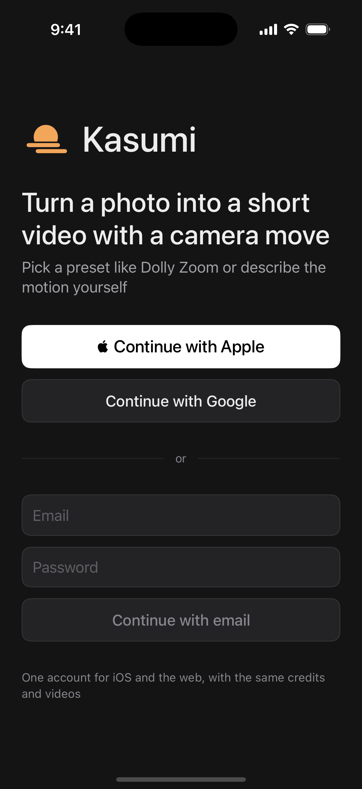
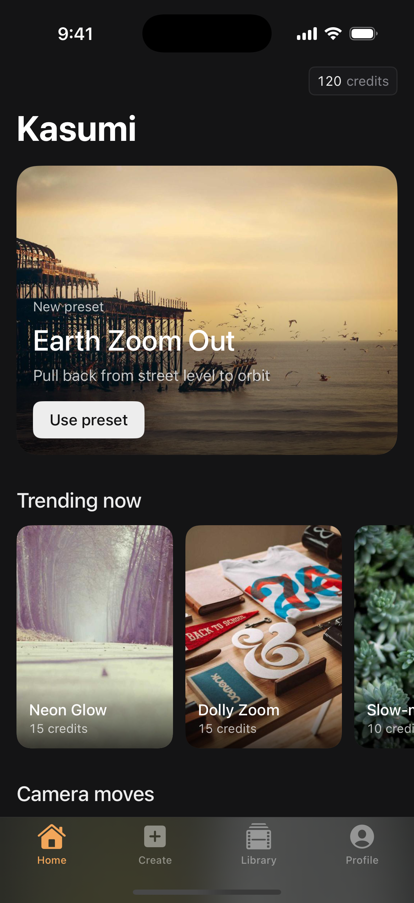
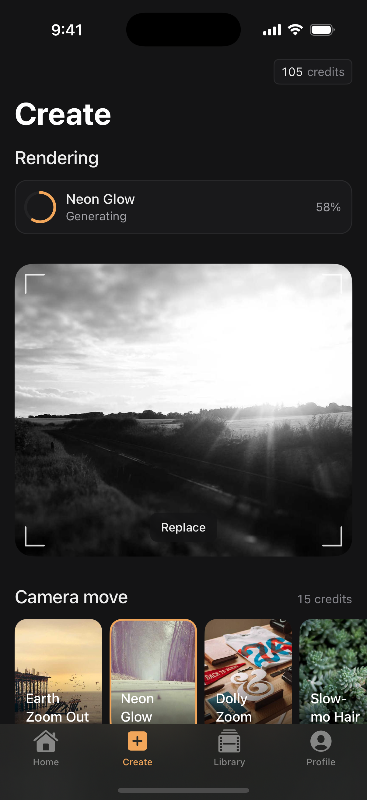
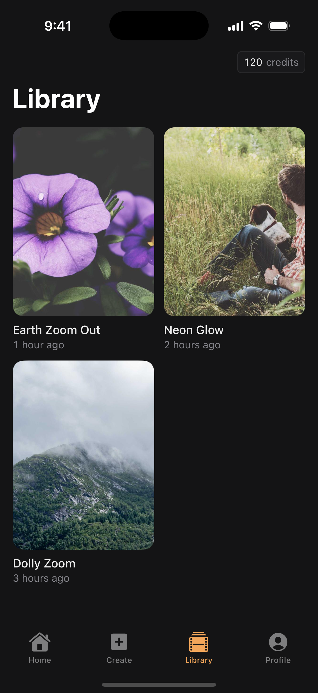
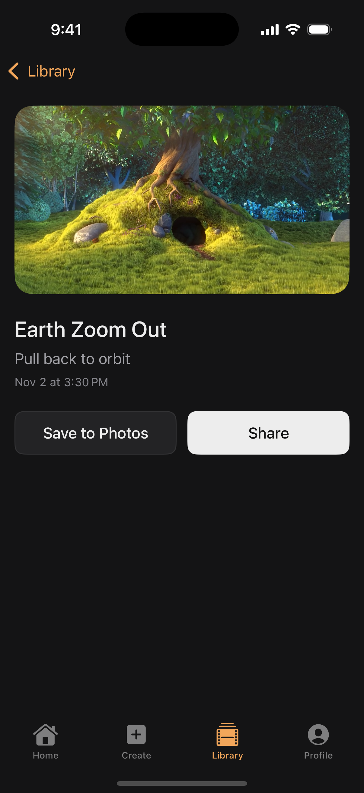
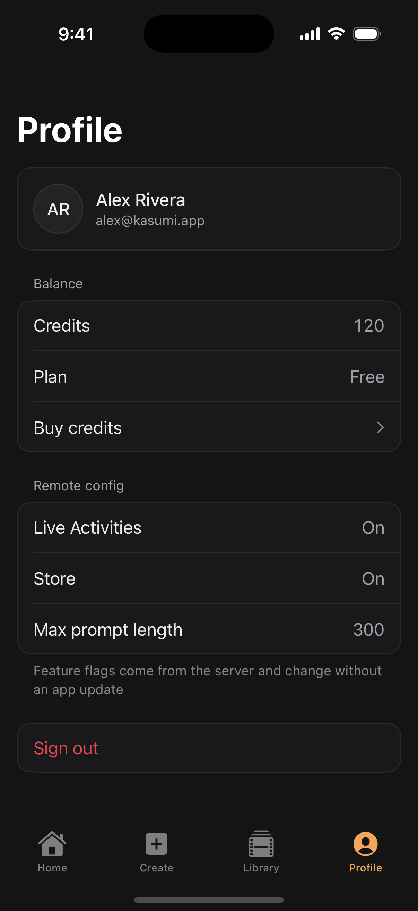

# Kasumi: AI video generation app (iOS MVP)

[](https://github.com/alisherizmukhan/kasumi-ios/actions/workflows/ios.yml)

Kasumi turns a photo into a short cinematic video. You pick a photo, choose a trending preset or write a prompt, and the app follows the render until the video is ready.

This is the first MVP of a consumer generative-video app, built with SwiftUI + UIKit interop, Swift 6 strict concurrency, and iOS 17+.

<p align="center">
  
  
  
  
</p>
<p align="center">
  
  
</p>

## Design

*Kasumi* (霞) is the haze that hangs over a landscape at dawn.

- **The interface stays quiet.** Surfaces use a neutral graphite palette, so the user's photos and videos carry the color.
- **One accent.** A warm amber, the light coming through the haze, marks selection, progress and the logo.
- **The logo.** A sun with two bands of mist passing in front of it, after the *suyari-gasumi* bands in Japanese screen painting. It is drawn in code (`KasumiMark` in `Shared/Brand.swift`) and reused for the app icon (`scripts/make_icon.py`) and the Live Activity.
- **A signature detail.** Viewfinder corner marks frame the photo you're about to animate.
- **Type and motion.**
  - System type at regular and medium weights.
  - Monospaced figures for credits and progress.
  - Spacing on a 4pt grid.
  - One easing curve for every animation.

## MVP scope

| Feature | Why it's in the MVP | Where |
|---|---|---|
| Sign in with Apple, Google, email (one account shared with web) | Credits and videos follow the user everywhere | `Features/Auth`, `AppModel` |
| Server-driven home with presets and trends | Marketing changes the screen without an app release | `Models/HomeScreen.swift`, `Features/Home` |
| Create: photo from gallery or camera + preset or prompt | The main mobile flow | `Features/Create` |
| Generation status, notification and Live Activity | Rendering takes minutes, so the user shouldn't have to wait in the app | `Core/Generation`, `KasumiWidgets` |
| Library with a video player | The reason users come back | `Features/Library` |
| Save to Photos and share | Sharing is how the product grows | `GenerationDetailView` |
| Credits and subscription (StoreKit 2) | Revenue | `Features/Store` |
| Analytics, crash reporting, feature flags / remote config | You can't run a product without them | `Core/Observability`, `RemoteConfig` |

## Architecture

```
Kasumi/
├── App/            entry point, AppModel (session, balance, config, tab routing), demo mode
├── Core/
│   ├── Networking/ APIClient: typed endpoints, auth, token refresh, retries, caching
│   ├── Backend/    Backend protocol + LiveBackend (REST) + MockBackend (offline demo)
│   ├── Generation/ GenerationTracker: polling, Live Activity, notifications
│   ├── Storage/    Keychain session storage
│   └── Observability/ analytics + crash reporting behind protocols
├── Features/       one folder per screen: View + ViewModel (MVVM, @Observable)
├── Models/         Codable, Sendable value types
└── UI/             theme and shared components
KasumiWidgets/       Live Activity (Lock Screen + Dynamic Island)
Shared/             ActivityAttributes shared by the app and the extension
KasumiTests/         unit tests
```

**MVVM with `@Observable`.** Views only lay out content and bind to state. ViewModels are `@MainActor` classes that own a screen's state and actions. `AppModel` holds only what several screens share.

**The backend sits behind a protocol.** Screens talk to `Backend`, never to `URLSession` directly. The app ships with `MockBackend`, so the whole product runs offline in the simulator. Switching to the real API is one line in `AppModel.live()`.

**Network layer.**
- Attaches the Bearer token.
- On a `401`, refreshes the token once and replays the request.
- Retries transient failures (5xx, 429, timeouts, lost connection) with exponential backoff. 4xx errors are never retried.
- Decodes responses into typed models and maps errors to user-facing messages.
- Leaves HTTP caching (ETag / `Cache-Control`) to `URLCache`.

All of this is covered by tests that use a stub `URLProtocol`.

**Server-driven UI with safe fallbacks.**
- Each home section has a `type`.
- If a newer server sends a type this version doesn't know, that section is skipped.
- A malformed section is also dropped instead of breaking the screen.
- If a refresh fails, the screen keeps showing the last layout that loaded.

**Generations take minutes.**
- `GenerationTracker` polls the status and keeps a Live Activity on the Lock Screen and in the Dynamic Island up to date.
- When the video is ready, it posts a notification.
- In production the backend would push both the notification (APNs) and Live Activity updates, so this also works after the app is killed.

**Payments.**
- Digital credits must use In-App Purchase, so the app uses StoreKit 2.
- The backend verifies each transaction and adds credits to the user's account, so the balance is the same on iOS and on the web.
- A `Transaction.updates` listener handles renewals and interrupted purchases.

**UIKit interop.** The camera wraps `UIImagePickerController` in `UIViewControllerRepresentable`, since SwiftUI has no camera view.

## Running

Requires Xcode 16+ and [XcodeGen](https://github.com/yonaskolb/XcodeGen). The project file is generated, so there are no merge conflicts in `.pbxproj`.

```bash
brew install xcodegen
xcodegen generate
open Kasumi.xcodeproj
```

Run the `Kasumi` scheme on an iPhone simulator. Purchases work locally with `StoreKit/Products.storekit`, which the scheme already references.

On the sign-in screen, use **Continue with Google** or any email with a password of 6+ characters. Sign in with Apple needs a signed build with the capability enabled.

**Demo mode:** launch with `-demoScreen home|create|library|detail|profile|store|auth` to open a screen with sample data. CI uses this to capture the screenshots above.

## Tests and CI

```bash
xcodebuild test -project Kasumi.xcodeproj -scheme Kasumi -destination 'platform=iOS Simulator,name=iPhone 16'
```

On every push, GitHub Actions generates the project, builds it, runs the tests and captures simulator screenshots, which you can download as a build artifact.

## Next steps

- Connect `LiveBackend`. Upload photos to presigned URLs instead of sending them in the request.
- Use APNs push for "video ready", plus push-to-update for Live Activities.
- Add the Google Sign-In SDK and the Sign in with Apple capability.
- Plug in real vendors behind the existing protocols: Amplitude or Firebase Analytics, Crashlytics or Sentry, Firebase Remote Config.
- Add offline caching of the home layout and library on disk.
- Write UI tests for the create flow and snapshot tests for the main components.
